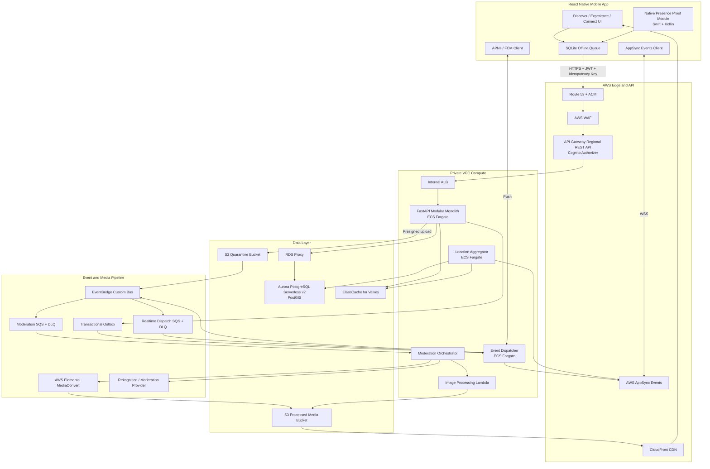
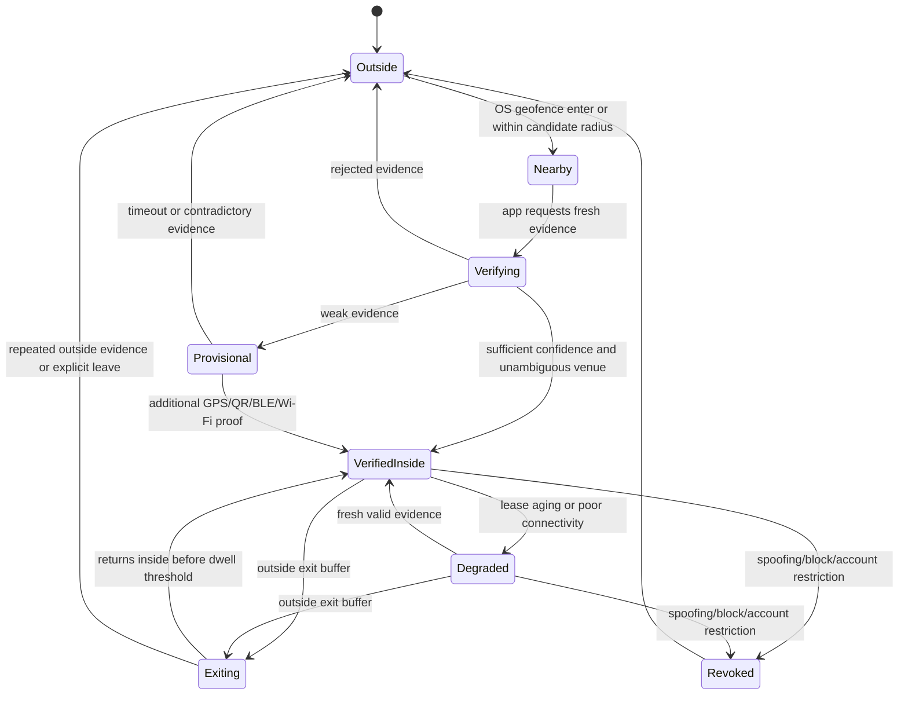
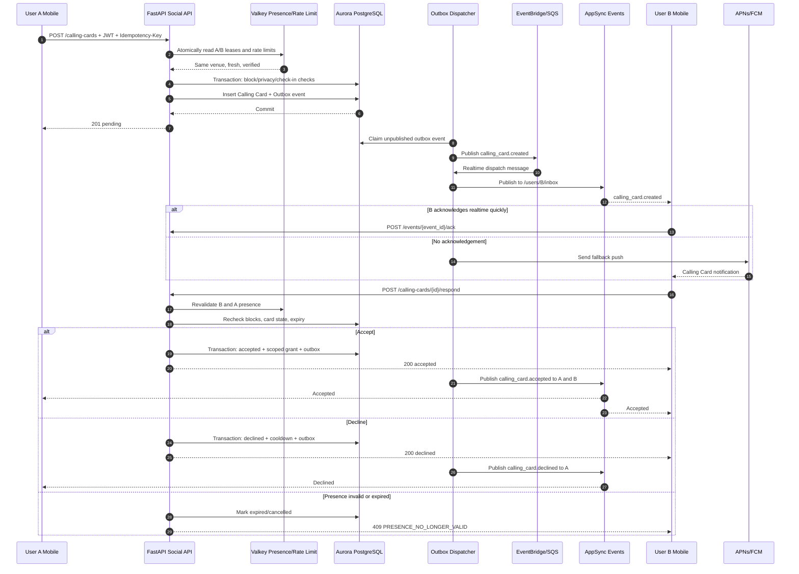
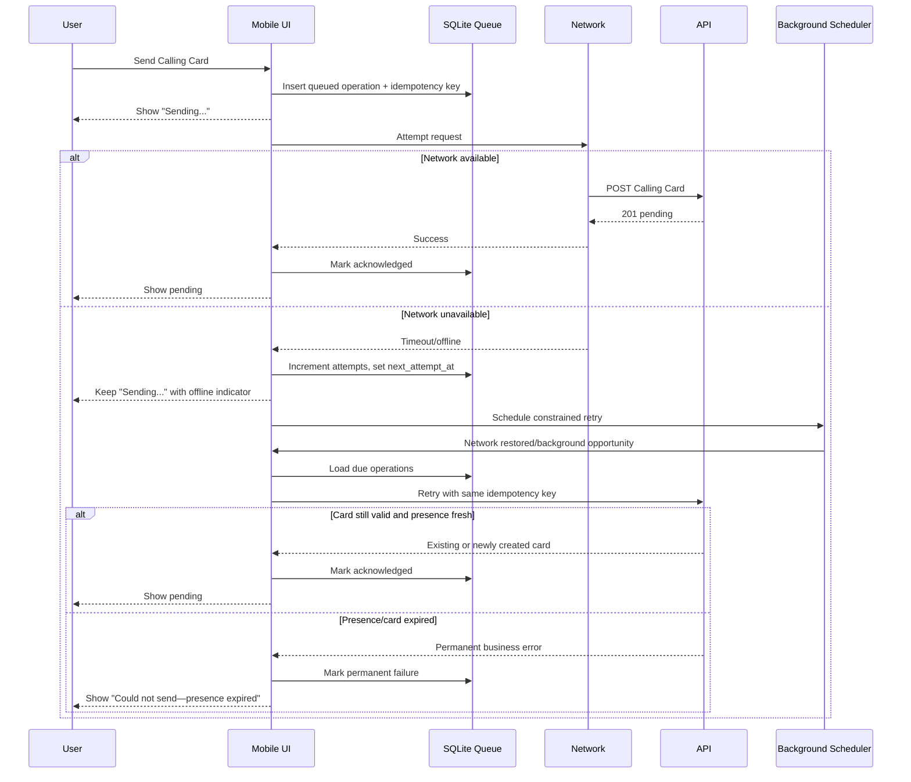

# Société — Production Architecture and Cursor Master Build Specification

**Document purpose:** Paste this entire specification into Cursor as the authoritative build plan for Société. Cursor must implement it phase by phase, keep the code runnable after every phase, and never invent unsupported mobile-platform capabilities.

**Important accuracy note:** No system design can honestly guarantee “100% accuracy” before real-device testing, venue-boundary calibration, load testing, security review, and App Store/Google Play review. This design removes the biggest technical mistakes, uses server-authoritative checks, and is structured for a safe MVP that can scale.

---

# 0. Cursor Operating Instructions

Act as a Principal Software Architect and Staff Engineer building a high-concurrency, privacy-sensitive, location-based mobile social network.

Build **Société**, a real-time nightlife discovery and in-venue social connection application.

Follow these rules:

1. Use the architecture, schemas, API contracts, state machines, and folder structure in this document.
2. Build the application in the implementation phases listed near the end.
3. After each phase:
   - run formatting;
   - run static typing;
   - run unit tests;
   - run integration tests;
   - run database migrations against a clean database;
   - update the OpenAPI specification;
   - update `README.md`;
   - stop and report any failing acceptance criteria before continuing.
4. Do not place secrets, API keys, signing keys, credentials, or private tokens in source code.
5. Do not trust mobile-client claims. The backend is authoritative for:
   - venue presence;
   - Calling Card eligibility;
   - blocking;
   - moderation state;
   - media publication;
   - rate limits;
   - privacy settings.
6. All write endpoints must support an `Idempotency-Key`.
7. All background processing must be safe for at-least-once delivery.
8. All events must have stable IDs and clients must deduplicate by event ID.
9. Do not expose a user’s precise latitude or longitude to another user.
10. Calling Cards must fail closed when venue-presence verification is missing, stale, ambiguous, or suspicious.
11. Do not begin with a large distributed microservice estate. Implement a modular monolith plus independently scalable workers. Preserve service boundaries so modules can be separated later.
12. Use feature flags for:
    - live crowd counts;
    - Calling Cards;
    - venue people discovery;
    - QR verification;
    - BLE verification;
    - media posting;
    - automated moderation;
    - Ghost Mode.
13. Use provider interfaces around Mapbox, moderation, push notifications, device attestation, and media transcoding.
14. Store all timestamps in UTC. Use the venue IANA timezone only to calculate venue-night boundaries, expiration, and the local 6:00 AM purge time.
15. Use UUIDv7 when the chosen libraries support it safely; otherwise use UUIDv4 consistently.
16. Produce production code, not demo-only code. Every unfinished integration must have an explicit interface, local stub, feature flag, and tracked TODO.

---

# 1. Product Definition and Non-Negotiable Rules

Société follows the product flow:

**Discover → Experience → Connect**

## 1.1 Discover

Users view a live map containing nearby nightlife venues and events.

Each venue pin may show:

- distance;
- venue category;
- price band;
- music genre;
- current vibe tags;
- a privacy-safe crowd level;
- broad age-band distribution;
- whether people are mainly dancing, socializing, watching an event, or relaxing;
- current media from the venue;
- queue or cover information when supplied by the venue.

The map must not expose individual user coordinates.

## 1.2 Experience

Users open a venue page and view currently approved short photos/videos called **Live Vibes**.

Live Vibes are:

- tied to a specific venue;
- time-limited;
- moderated before public publication;
- delivered through a CDN;
- hidden immediately when reported and risk thresholds require quarantine;
- visible to the uploader as `processing` while moderation/transcoding is pending.

## 1.3 Connect

Users who explicitly opt into being discoverable can see eligible people verified at the same venue.

A **Calling Card** is a lightweight in-venue social request.

Hard authorization rule:

> User A may send a Calling Card to User B only when both users have fresh, server-verified presence leases for the exact same venue, both are discoverable, neither is in Ghost Mode, neither has blocked the other, and all safety/rate-limit checks pass.

Acceptance does not automatically reveal all profile information. Information is shared only through explicit, scoped grants.

## 1.4 Ghost Mode

Ghost Mode means:

- the user can browse public map and venue-vibe content;
- the user is not included in discoverable-user lists;
- the user is not included in public venue headcounts when the count represents opted-in users;
- the user cannot send or receive Calling Cards while Ghost Mode is active;
- precise location is still processed only when necessary to provide requested location features;
- disabling Ghost Mode requires a fresh presence verification before social features are restored.

## 1.5 Privacy-safe crowd display

Do not show exact headcounts for small groups.

Default policy:

- fewer than 5 active users: show `Not enough live data`;
- 5 or more: round to the nearest 5 or show a bucket;
- delay public metrics by 60–120 seconds;
- never expose exact demographic combinations that could identify a person;
- suppress demographic slices smaller than the configured k-anonymity threshold.

Recommended crowd buckets:

- `quiet`
- `moderate`
- `busy`
- `packed`

---

# 2. Architecture Decision Summary

## 2.1 Recommended cloud

Use **AWS**.

Why:

- the project already fits FastAPI, PostgreSQL, AWS SES/SNS, and Docker skills;
- Aurora PostgreSQL supports PostGIS;
- AppSync Events removes the need to operate a WebSocket fleet;
- S3, MediaConvert, Rekognition, CloudFront, SQS, EventBridge, Cognito, WAF, and Fargate form a coherent managed stack;
- scheduled and target-tracking scaling fit predictable Thursday–Saturday spikes.

GCP is viable with Cloud Run, Cloud SQL/PostGIS, Memorystore, Pub/Sub, Firebase, and Cloud CDN, but do not split the first production version across both clouds.

## 2.2 Mobile

Use:

- React Native;
- TypeScript;
- current stable Expo SDK with a **custom development client and prebuild**, not Expo Go;
- Expo Router;
- TanStack Query;
- Zustand for small ephemeral UI state;
- SQLite for durable offline state and operation queues;
- SecureStore/Keychain/Android Keystore for authentication material;
- a native iOS module in Swift for advanced Core Location behavior;
- a native Android module in Kotlin for GeofencingClient, fused location, Play Integrity, and WorkManager;
- Mapbox through a `MapProvider` interface.

React Native provides delivery speed, while custom native modules preserve access to platform-specific location and attestation APIs.

## 2.3 Backend

Use:

- Python 3.12+;
- FastAPI;
- Pydantic v2;
- SQLAlchemy 2 async;
- asyncpg;
- Alembic;
- redis-py asyncio client for Valkey;
- boto3/AWS SDK;
- OpenTelemetry;
- structlog JSON logging;
- Ruff;
- mypy;
- pytest.

Initial deployment model:

- `api`: modular FastAPI application;
- `event-dispatcher`: outbox/EventBridge/AppSync/push worker;
- `location-aggregator`: crowd metrics and presence cleanup worker;
- `moderation-worker`: moderation orchestration;
- serverless media-processing functions;
- managed AWS services.

## 2.4 Edge and API

Use:

- Route 53;
- AWS Certificate Manager;
- AWS WAF;
- API Gateway **Regional REST API**;
- Cognito authorizer;
- VPC Link V2;
- internal Application Load Balancer;
- ECS Fargate API tasks in private subnets.

A REST API is selected over API Gateway HTTP API because the launch design requires direct WAF integration, request validation, and richer throttling controls.

Do not use API keys as a security boundary for the consumer mobile app. Mobile API keys are extractable. Use JWT identity, device attestation, per-user/per-device rate limits, and WAF.

## 2.5 Real-time delivery

Use **AWS AppSync Events** for managed WebSocket pub/sub.

Rules:

- clients subscribe only to authorized private channels;
- sensitive commands are never accepted directly from a WebSocket channel;
- Calling Card creation and responses go through authenticated REST endpoints;
- backend commits business state first, then publishes events through the transactional outbox;
- APNs/FCM push is the fallback when WebSocket delivery is not acknowledged quickly.

Private channel examples:

- `/users/{user_id}/inbox`
- `/users/{user_id}/presence`
- `/venues/{venue_id}/metrics`
- `/uploads/{upload_id}/status`

The authorization handler must verify that the JWT subject owns the private user channel. Venue metric channels may be public-to-authenticated users, but must contain only aggregated data.

## 2.6 Persistence

Use:

- Amazon Aurora PostgreSQL Serverless v2;
- PostGIS;
- RDS Proxy;
- ElastiCache for Valkey;
- S3 private buckets;
- CloudFront;
- EventBridge;
- SQS with dead-letter queues.

Authoritative ownership:

- PostgreSQL: durable users, venues, check-ins, Calling Cards, blocks, moderation state, media metadata, privacy configuration, outbox;
- Valkey: short-lived presence leases, rate limits, crowd membership, map/live-metric cache, deduplication;
- S3: original quarantined uploads and processed media;
- AppSync Events: real-time delivery, not durable business state;
- EventBridge/SQS: event fanout and retry.

## 2.7 Compute

Use a hybrid:

- ECS Fargate for the API and continuously running workers;
- Lambda for short bursty orchestration and image tasks;
- MediaConvert for video transcoding;
- do not use EKS for the initial release;
- do not put the entire backend in Lambda because geospatial transactions, connection behavior, and predictable peak windows are easier to control in Fargate.

---

# 3. High-Level System Diagram



---

# 4. Logical Service Decomposition

These are bounded contexts. Initially, several run in one FastAPI deployment while preserving package boundaries.

## 4.1 Identity and Profile Module

Responsibilities:

- Cognito identity mapping;
- onboarding;
- handle/display name;
- age-verification state;
- profile attributes;
- social links;
- profile visibility;
- device registration;
- push-token registration;
- account deletion;
- privacy export request.

It must not own precise location.

## 4.2 Venue and Discovery Module

Responsibilities:

- venue catalog;
- venue polygons;
- venue entrance points;
- opening hours;
- category, music, price, age restriction;
- venue search;
- nearby-venue query;
- map filter parsing;
- static venue cache;
- venue-specific configuration.

## 4.3 Presence and Geofencing Module

Responsibilities:

- accept location evidence;
- validate evidence freshness and accuracy;
- validate attestation;
- calculate candidate venues;
- run exact PostGIS checks;
- calculate a presence-confidence score;
- create, refresh, degrade, revoke, and exit check-ins;
- maintain Valkey presence leases;
- generate only transition events, not one event per GPS ping;
- support QR/BLE/Wi-Fi proof adapters;
- expose presence status to the current user;
- provide server-side eligibility checks to the Social module.

## 4.4 Live Vibes and Media Module

Responsibilities:

- upload-session creation;
- presigned multipart uploads;
- media metadata;
- checksum verification;
- media finalization;
- vibe creation;
- moderation state;
- publication state;
- expiration;
- feed query;
- report/quarantine integration.

## 4.5 Social and Calling Card Module

Responsibilities:

- discoverable in-venue user list;
- Calling Card authorization;
- Calling Card creation;
- accept/decline;
- information-sharing grants;
- temporary status such as `OTW`;
- card expiration;
- rate limits and cooldowns;
- block checks;
- report integration.

## 4.6 Realtime and Notification Module

Responsibilities:

- outbox polling;
- EventBridge publication;
- AppSync event publication;
- push fallback;
- event deduplication;
- delivery acknowledgements;
- notification preferences;
- retry and DLQ processing.

## 4.7 Trust and Safety Module

Responsibilities:

- blocks;
- reports;
- moderation cases;
- policy decisions;
- user risk/reputation;
- location-spoofing signals;
- device attestation;
- temporary restrictions;
- audit trail;
- appeals.

## 4.8 Venue Analytics Module

Responsibilities:

- active lease counts;
- privacy-safe crowd buckets;
- aggregated broad demographics;
- vibe trends;
- queue/cover partner data;
- minute buckets;
- venue dashboards later.

## 4.9 Service split triggers

Do not split a module solely because it is conceptually separate.

Split when one or more is true:

- it requires independent scaling by more than 5×;
- it has a materially different failure domain;
- it needs a different runtime;
- it has a separate security boundary;
- deployments frequently interfere with another team;
- database workload must be isolated.

Likely first splits:

1. Presence/Location Ingest;
2. Media/Moderation;
3. Realtime Dispatcher.

---

# 5. Repository Structure

```text
societe/
├── apps/
│   └── mobile/
│       ├── app/                         # Expo Router routes
│       ├── src/
│       │   ├── api/
│       │   ├── auth/
│       │   ├── components/
│       │   ├── features/
│       │   │   ├── discover/
│       │   │   ├── experience/
│       │   │   ├── presence/
│       │   │   ├── calling-cards/
│       │   │   ├── profile/
│       │   │   └── safety/
│       │   ├── location/
│       │   ├── offline/
│       │   ├── realtime/
│       │   ├── storage/
│       │   └── telemetry/
│       ├── modules/
│       │   └── presence-proof/          # Expo native module
│       │       ├── ios/                 # Swift
│       │       ├── android/             # Kotlin
│       │       └── src/                 # TypeScript spec
│       ├── app.config.ts
│       └── package.json
├── services/
│   ├── api/
│   │   ├── app/
│   │   │   ├── main.py
│   │   │   ├── core/
│   │   │   ├── db/
│   │   │   ├── modules/
│   │   │   │   ├── identity/
│   │   │   │   ├── venues/
│   │   │   │   ├── presence/
│   │   │   │   ├── vibes/
│   │   │   │   ├── social/
│   │   │   │   ├── safety/
│   │   │   │   └── reports/
│   │   │   └── shared/
│   │   ├── migrations/
│   │   ├── tests/
│   │   └── pyproject.toml
│   └── workers/
│       ├── event_dispatcher/
│       ├── location_aggregator/
│       └── moderation/
├── packages/
│   ├── contracts/                       # OpenAPI, JSON Schema, event schemas
│   ├── config/
│   └── test-fixtures/
├── infra/
│   ├── terraform/
│   │   ├── modules/
│   │   └── environments/
│   │       ├── dev/
│   │       ├── staging/
│   │       └── prod/
│   └── docker/
├── docs/
│   ├── adr/
│   ├── runbooks/
│   ├── threat-model/
│   └── data-retention/
├── scripts/
├── docker-compose.yml
├── Makefile
└── README.md
```

---

# 6. Local Development

Use Docker Compose with:

- PostgreSQL 16 + PostGIS;
- Valkey;
- MinIO as an S3-compatible local store;
- LocalStack only for integrations that truly need AWS emulation;
- a local JWT issuer or test Cognito adapter;
- Mailpit for local email if needed.

Required commands:

```text
make bootstrap
make dev
make migrate
make seed
make test
make lint
make typecheck
make load-test
```

Seed data must include:

- several Los Angeles venues;
- real-looking but synthetic polygons;
- adjacent venue boundaries for ambiguity tests;
- one basement venue;
- one venue with QR verification;
- synthetic users;
- synthetic approved/pending/rejected vibes;
- synthetic Calling Cards.

Never use real user coordinates, faces, phone numbers, or private venue-network identifiers in test fixtures.

---

# 7. Database Architecture

## 7.1 Database principles

1. PostgreSQL/PostGIS is the durable source of truth.
2. Valkey stores short-lived, rebuildable state.
3. Every client-visible write is idempotent.
4. Every durable event uses a transactional outbox.
5. Raw location is not retained by default.
6. Durable check-ins contain venue identity and timestamps, not a route history.
7. Exact coordinates are never included in analytics tables.
8. High-frequency heartbeats update Valkey; PostgreSQL is updated on meaningful state transitions and controlled lease checkpoints.
9. Spatial truth uses PostGIS polygons. H3/geohash is an acceleration and cache-sharding mechanism, never the final authorization check.
10. Add indexes based on measured query plans. Include `EXPLAIN (ANALYZE, BUFFERS)` tests for key spatial queries.

## 7.2 Initial SQL DDL

```sql
CREATE EXTENSION IF NOT EXISTS postgis;
CREATE EXTENSION IF NOT EXISTS pgcrypto;

CREATE SCHEMA IF NOT EXISTS app;
CREATE SCHEMA IF NOT EXISTS ephemeral;
CREATE SCHEMA IF NOT EXISTS audit;

CREATE TABLE app.users (
    id UUID PRIMARY KEY DEFAULT gen_random_uuid(),
    auth_subject TEXT NOT NULL UNIQUE,
    handle TEXT NOT NULL,
    display_name TEXT NOT NULL,
    bio TEXT,
    age_verified BOOLEAN NOT NULL DEFAULT FALSE,
    age_band TEXT CHECK (age_band IN ('18-20', '21-24', '25-29', '30-34', '35+')),
    account_status TEXT NOT NULL DEFAULT 'active'
        CHECK (account_status IN ('active', 'restricted', 'suspended', 'deleted')),
    created_at TIMESTAMPTZ NOT NULL DEFAULT now(),
    updated_at TIMESTAMPTZ NOT NULL DEFAULT now(),
    deleted_at TIMESTAMPTZ
);

CREATE UNIQUE INDEX uq_users_handle_lower
    ON app.users (lower(handle))
    WHERE deleted_at IS NULL;

CREATE TABLE app.user_privacy_settings (
    user_id UUID PRIMARY KEY REFERENCES app.users(id) ON DELETE CASCADE,
    ghost_mode BOOLEAN NOT NULL DEFAULT FALSE,
    discoverable_in_venue BOOLEAN NOT NULL DEFAULT FALSE,
    allow_calling_cards BOOLEAN NOT NULL DEFAULT TRUE,
    show_social_links_after_accept BOOLEAN NOT NULL DEFAULT FALSE,
    analytics_opt_out BOOLEAN NOT NULL DEFAULT FALSE,
    updated_at TIMESTAMPTZ NOT NULL DEFAULT now()
);

CREATE TABLE app.user_devices (
    id UUID PRIMARY KEY DEFAULT gen_random_uuid(),
    user_id UUID NOT NULL REFERENCES app.users(id) ON DELETE CASCADE,
    platform TEXT NOT NULL CHECK (platform IN ('ios', 'android')),
    installation_id UUID NOT NULL,
    app_version TEXT,
    os_version TEXT,
    push_token_ciphertext BYTEA,
    push_token_hash BYTEA,
    attestation_key_id TEXT,
    attestation_status TEXT NOT NULL DEFAULT 'unknown'
        CHECK (attestation_status IN ('unknown', 'valid', 'degraded', 'invalid')),
    last_seen_at TIMESTAMPTZ,
    revoked_at TIMESTAMPTZ,
    created_at TIMESTAMPTZ NOT NULL DEFAULT now(),
    UNIQUE (platform, installation_id)
);

CREATE UNIQUE INDEX uq_user_devices_push_hash
    ON app.user_devices(push_token_hash)
    WHERE push_token_hash IS NOT NULL AND revoked_at IS NULL;

CREATE TABLE app.user_blocks (
    blocker_user_id UUID NOT NULL REFERENCES app.users(id) ON DELETE CASCADE,
    blocked_user_id UUID NOT NULL REFERENCES app.users(id) ON DELETE CASCADE,
    reason_code TEXT,
    created_at TIMESTAMPTZ NOT NULL DEFAULT now(),
    PRIMARY KEY (blocker_user_id, blocked_user_id),
    CHECK (blocker_user_id <> blocked_user_id)
);

CREATE INDEX ix_user_blocks_reverse
    ON app.user_blocks (blocked_user_id, blocker_user_id);

CREATE OR REPLACE FUNCTION app.is_blocked(a UUID, b UUID)
RETURNS BOOLEAN
LANGUAGE sql
STABLE
AS $$
    SELECT EXISTS (
        SELECT 1
        FROM app.user_blocks ub
        WHERE (ub.blocker_user_id = a AND ub.blocked_user_id = b)
           OR (ub.blocker_user_id = b AND ub.blocked_user_id = a)
    );
$$;

CREATE TABLE app.venues (
    id UUID PRIMARY KEY DEFAULT gen_random_uuid(),
    slug TEXT NOT NULL UNIQUE,
    name TEXT NOT NULL,
    description TEXT,
    category TEXT NOT NULL,
    status TEXT NOT NULL DEFAULT 'active'
        CHECK (status IN ('draft', 'active', 'temporarily_closed', 'closed')),
    street_address TEXT,
    city TEXT NOT NULL,
    region TEXT,
    country_code CHAR(2) NOT NULL,
    timezone TEXT NOT NULL,
    minimum_age SMALLINT,
    price_band SMALLINT CHECK (price_band BETWEEN 1 AND 4),
    music_tags TEXT[] NOT NULL DEFAULT '{}',
    experience_tags TEXT[] NOT NULL DEFAULT '{}',
    boundary GEOMETRY(MULTIPOLYGON, 4326) NOT NULL,
    centroid GEOGRAPHY(POINT, 4326) NOT NULL,
    entrance_point GEOGRAPHY(POINT, 4326),
    geofence_version INTEGER NOT NULL DEFAULT 1,
    max_gps_accuracy_m REAL NOT NULL DEFAULT 50,
    entry_dwell_seconds INTEGER NOT NULL DEFAULT 10,
    exit_dwell_seconds INTEGER NOT NULL DEFAULT 30,
    entry_buffer_m REAL NOT NULL DEFAULT 10,
    exit_buffer_m REAL NOT NULL DEFAULT 25,
    supports_qr_proof BOOLEAN NOT NULL DEFAULT FALSE,
    supports_ble_proof BOOLEAN NOT NULL DEFAULT FALSE,
    supports_wifi_proof BOOLEAN NOT NULL DEFAULT FALSE,
    created_at TIMESTAMPTZ NOT NULL DEFAULT now(),
    updated_at TIMESTAMPTZ NOT NULL DEFAULT now(),
    CHECK (ST_IsValid(boundary))
);

CREATE INDEX ix_venues_boundary_gist
    ON app.venues USING GIST (boundary);

CREATE INDEX ix_venues_centroid_gist
    ON app.venues USING GIST (centroid);

CREATE INDEX ix_venues_city_status
    ON app.venues (city, status);

CREATE TABLE app.venue_wifi_fingerprints (
    id UUID PRIMARY KEY DEFAULT gen_random_uuid(),
    venue_id UUID NOT NULL REFERENCES app.venues(id) ON DELETE CASCADE,
    bssid_hmac BYTEA NOT NULL,
    key_version SMALLINT NOT NULL,
    valid_from TIMESTAMPTZ NOT NULL DEFAULT now(),
    valid_to TIMESTAMPTZ,
    created_at TIMESTAMPTZ NOT NULL DEFAULT now(),
    UNIQUE (venue_id, bssid_hmac, key_version)
);

CREATE TABLE app.venue_beacons (
    id UUID PRIMARY KEY DEFAULT gen_random_uuid(),
    venue_id UUID NOT NULL REFERENCES app.venues(id) ON DELETE CASCADE,
    public_identifier TEXT NOT NULL UNIQUE,
    rotating_key_reference TEXT NOT NULL,
    status TEXT NOT NULL DEFAULT 'active'
        CHECK (status IN ('active', 'disabled', 'retired')),
    created_at TIMESTAMPTZ NOT NULL DEFAULT now()
);

CREATE TABLE app.check_ins (
    id UUID PRIMARY KEY DEFAULT gen_random_uuid(),
    user_id UUID NOT NULL REFERENCES app.users(id) ON DELETE CASCADE,
    venue_id UUID NOT NULL REFERENCES app.venues(id) ON DELETE CASCADE,
    state TEXT NOT NULL
        CHECK (state IN ('provisional', 'verified', 'degraded', 'exited', 'revoked')),
    verification_level TEXT NOT NULL
        CHECK (verification_level IN ('weak', 'standard', 'strong')),
    confidence_score SMALLINT NOT NULL CHECK (confidence_score BETWEEN 0 AND 100),
    entry_method TEXT NOT NULL
        CHECK (entry_method IN ('fused_location', 'wifi', 'ble', 'qr', 'hybrid', 'manual')),
    ghost_mode_snapshot BOOLEAN NOT NULL,
    discoverable_snapshot BOOLEAN NOT NULL,
    entered_at TIMESTAMPTZ NOT NULL,
    verified_at TIMESTAMPTZ,
    last_verified_at TIMESTAMPTZ,
    lease_expires_at TIMESTAMPTZ NOT NULL,
    exited_at TIMESTAMPTZ,
    exit_reason TEXT,
    risk_reasons JSONB NOT NULL DEFAULT '[]'::jsonb,
    geofence_version INTEGER NOT NULL,
    created_at TIMESTAMPTZ NOT NULL DEFAULT now(),
    updated_at TIMESTAMPTZ NOT NULL DEFAULT now()
);

CREATE UNIQUE INDEX uq_check_ins_one_active_per_user
    ON app.check_ins(user_id)
    WHERE state IN ('provisional', 'verified', 'degraded');

CREATE INDEX ix_check_ins_venue_active
    ON app.check_ins(venue_id, lease_expires_at)
    WHERE state IN ('verified', 'degraded');

CREATE INDEX ix_check_ins_user_recent
    ON app.check_ins(user_id, entered_at DESC);

CREATE TABLE ephemeral.location_evidence (
    id UUID NOT NULL DEFAULT gen_random_uuid(),
    user_id UUID NOT NULL REFERENCES app.users(id) ON DELETE CASCADE,
    check_in_id UUID REFERENCES app.check_ins(id) ON DELETE SET NULL,
    observed_at TIMESTAMPTZ NOT NULL,
    received_at TIMESTAMPTZ NOT NULL DEFAULT now(),
    point GEOGRAPHY(POINT, 4326) NOT NULL,
    horizontal_accuracy_m REAL NOT NULL CHECK (horizontal_accuracy_m >= 0),
    speed_mps REAL,
    altitude_m REAL,
    source TEXT NOT NULL,
    is_mock BOOLEAN,
    is_simulated BOOLEAN,
    device_attestation_status TEXT,
    ip_region_hash BYTEA,
    wifi_bssid_hmac BYTEA,
    qr_nonce_hash BYTEA,
    ble_proof_hash BYTEA,
    risk_score SMALLINT NOT NULL CHECK (risk_score BETWEEN 0 AND 100),
    risk_reasons JSONB NOT NULL DEFAULT '[]'::jsonb,
    purge_at TIMESTAMPTZ NOT NULL,
    PRIMARY KEY (id, purge_at)
) PARTITION BY RANGE (purge_at);

-- Create partitions ahead of time with an automated migration/maintenance job.
-- Example only:
CREATE TABLE IF NOT EXISTS ephemeral.location_evidence_default
    PARTITION OF ephemeral.location_evidence DEFAULT;

CREATE INDEX ix_location_evidence_user_time
    ON ephemeral.location_evidence_default(user_id, observed_at DESC);

CREATE INDEX ix_location_evidence_point_gist
    ON ephemeral.location_evidence_default USING GIST(point);

CREATE TABLE app.media_assets (
    id UUID PRIMARY KEY DEFAULT gen_random_uuid(),
    owner_user_id UUID NOT NULL REFERENCES app.users(id) ON DELETE CASCADE,
    media_type TEXT NOT NULL CHECK (media_type IN ('image', 'video')),
    upload_status TEXT NOT NULL
        CHECK (upload_status IN ('created', 'uploading', 'uploaded', 'processing', 'ready', 'failed', 'deleted')),
    moderation_status TEXT NOT NULL DEFAULT 'pending'
        CHECK (moderation_status IN ('pending', 'approved', 'rejected', 'manual_review', 'quarantined')),
    quarantine_object_key TEXT NOT NULL,
    processed_object_key TEXT,
    thumbnail_object_key TEXT,
    hls_manifest_key TEXT,
    mime_type TEXT NOT NULL,
    original_filename TEXT,
    byte_size BIGINT,
    width INTEGER,
    height INTEGER,
    duration_ms INTEGER,
    checksum_sha256 TEXT,
    moderation_summary JSONB NOT NULL DEFAULT '{}'::jsonb,
    created_at TIMESTAMPTZ NOT NULL DEFAULT now(),
    uploaded_at TIMESTAMPTZ,
    processed_at TIMESTAMPTZ,
    deleted_at TIMESTAMPTZ
);

CREATE INDEX ix_media_assets_owner_created
    ON app.media_assets(owner_user_id, created_at DESC);

CREATE INDEX ix_media_assets_processing
    ON app.media_assets(upload_status, moderation_status)
    WHERE upload_status IN ('uploaded', 'processing');

CREATE TABLE app.live_vibes (
    id UUID PRIMARY KEY DEFAULT gen_random_uuid(),
    venue_id UUID NOT NULL REFERENCES app.venues(id) ON DELETE CASCADE,
    author_user_id UUID NOT NULL REFERENCES app.users(id) ON DELETE CASCADE,
    media_asset_id UUID NOT NULL UNIQUE REFERENCES app.media_assets(id) ON DELETE CASCADE,
    author_check_in_id UUID NOT NULL REFERENCES app.check_ins(id) ON DELETE RESTRICT,
    caption TEXT,
    vibe_tags TEXT[] NOT NULL DEFAULT '{}',
    publication_status TEXT NOT NULL DEFAULT 'processing'
        CHECK (publication_status IN ('processing', 'published', 'hidden', 'expired', 'removed')),
    created_at TIMESTAMPTZ NOT NULL DEFAULT now(),
    published_at TIMESTAMPTZ,
    expires_at TIMESTAMPTZ NOT NULL,
    hidden_at TIMESTAMPTZ,
    hidden_reason TEXT
);

CREATE INDEX ix_live_vibes_venue_feed
    ON app.live_vibes(venue_id, published_at DESC)
    WHERE publication_status = 'published';

CREATE INDEX ix_live_vibes_expiration
    ON app.live_vibes(expires_at)
    WHERE publication_status IN ('processing', 'published');

CREATE TABLE app.calling_cards (
    id UUID PRIMARY KEY DEFAULT gen_random_uuid(),
    sender_user_id UUID NOT NULL REFERENCES app.users(id) ON DELETE CASCADE,
    recipient_user_id UUID NOT NULL REFERENCES app.users(id) ON DELETE CASCADE,
    venue_id UUID NOT NULL REFERENCES app.venues(id) ON DELETE CASCADE,
    sender_check_in_id UUID NOT NULL REFERENCES app.check_ins(id) ON DELETE RESTRICT,
    recipient_check_in_id UUID NOT NULL REFERENCES app.check_ins(id) ON DELETE RESTRICT,
    pair_low UUID GENERATED ALWAYS AS (LEAST(sender_user_id, recipient_user_id)) STORED,
    pair_high UUID GENERATED ALWAYS AS (GREATEST(sender_user_id, recipient_user_id)) STORED,
    reason_code TEXT,
    reason_text TEXT,
    status TEXT NOT NULL DEFAULT 'pending'
        CHECK (status IN ('pending', 'accepted', 'declined', 'expired', 'cancelled', 'blocked')),
    idempotency_key TEXT NOT NULL,
    created_at TIMESTAMPTZ NOT NULL DEFAULT now(),
    expires_at TIMESTAMPTZ NOT NULL,
    responded_at TIMESTAMPTZ,
    response_action TEXT
        CHECK (response_action IS NULL OR response_action IN ('share_info', 'make_move', 'accept_only')),
    cancelled_reason TEXT,
    CHECK (sender_user_id <> recipient_user_id),
    UNIQUE(sender_user_id, idempotency_key)
);

CREATE UNIQUE INDEX uq_calling_cards_one_pending_pair
    ON app.calling_cards(pair_low, pair_high, venue_id)
    WHERE status = 'pending';

CREATE INDEX ix_calling_cards_recipient_pending
    ON app.calling_cards(recipient_user_id, created_at DESC)
    WHERE status = 'pending';

CREATE INDEX ix_calling_cards_sender_recent
    ON app.calling_cards(sender_user_id, created_at DESC);

CREATE TABLE app.connection_grants (
    id UUID PRIMARY KEY DEFAULT gen_random_uuid(),
    calling_card_id UUID NOT NULL UNIQUE REFERENCES app.calling_cards(id) ON DELETE CASCADE,
    user_a_id UUID NOT NULL REFERENCES app.users(id) ON DELETE CASCADE,
    user_b_id UUID NOT NULL REFERENCES app.users(id) ON DELETE CASCADE,
    scopes JSONB NOT NULL DEFAULT '[]'::jsonb,
    created_at TIMESTAMPTZ NOT NULL DEFAULT now(),
    expires_at TIMESTAMPTZ NOT NULL,
    revoked_at TIMESTAMPTZ,
    revoked_reason TEXT
);

CREATE TABLE app.user_status_events (
    id UUID PRIMARY KEY DEFAULT gen_random_uuid(),
    user_id UUID NOT NULL REFERENCES app.users(id) ON DELETE CASCADE,
    venue_id UUID NOT NULL REFERENCES app.venues(id) ON DELETE CASCADE,
    calling_card_id UUID REFERENCES app.calling_cards(id) ON DELETE CASCADE,
    status_code TEXT NOT NULL CHECK (status_code IN ('otw', 'at_bar', 'on_dance_floor', 'leaving')),
    created_at TIMESTAMPTZ NOT NULL DEFAULT now(),
    expires_at TIMESTAMPTZ NOT NULL
);

CREATE TABLE app.moderation_cases (
    id UUID PRIMARY KEY DEFAULT gen_random_uuid(),
    media_asset_id UUID REFERENCES app.media_assets(id) ON DELETE CASCADE,
    subject_user_id UUID REFERENCES app.users(id) ON DELETE CASCADE,
    status TEXT NOT NULL
        CHECK (status IN ('open', 'auto_approved', 'auto_rejected', 'needs_review', 'resolved', 'appealed')),
    policy_version TEXT NOT NULL,
    final_action TEXT,
    reviewer_id TEXT,
    created_at TIMESTAMPTZ NOT NULL DEFAULT now(),
    resolved_at TIMESTAMPTZ
);

CREATE TABLE app.moderation_signals (
    id UUID PRIMARY KEY DEFAULT gen_random_uuid(),
    moderation_case_id UUID NOT NULL REFERENCES app.moderation_cases(id) ON DELETE CASCADE,
    provider TEXT NOT NULL,
    model_version TEXT,
    category TEXT NOT NULL,
    confidence NUMERIC(5,2),
    raw_reference TEXT,
    created_at TIMESTAMPTZ NOT NULL DEFAULT now()
);

CREATE TABLE app.reports (
    id UUID PRIMARY KEY DEFAULT gen_random_uuid(),
    reporter_user_id UUID NOT NULL REFERENCES app.users(id) ON DELETE CASCADE,
    reported_user_id UUID REFERENCES app.users(id) ON DELETE CASCADE,
    live_vibe_id UUID REFERENCES app.live_vibes(id) ON DELETE CASCADE,
    calling_card_id UUID REFERENCES app.calling_cards(id) ON DELETE CASCADE,
    category TEXT NOT NULL,
    description TEXT,
    status TEXT NOT NULL DEFAULT 'open'
        CHECK (status IN ('open', 'triaged', 'resolved', 'dismissed')),
    created_at TIMESTAMPTZ NOT NULL DEFAULT now(),
    resolved_at TIMESTAMPTZ
);

CREATE TABLE app.venue_metric_buckets (
    venue_id UUID NOT NULL REFERENCES app.venues(id) ON DELETE CASCADE,
    bucket_start TIMESTAMPTZ NOT NULL,
    active_count INTEGER NOT NULL,
    discoverable_count INTEGER NOT NULL,
    crowd_bucket TEXT,
    broad_demographics JSONB NOT NULL DEFAULT '{}'::jsonb,
    vibe_distribution JSONB NOT NULL DEFAULT '{}'::jsonb,
    privacy_suppressed BOOLEAN NOT NULL DEFAULT FALSE,
    created_at TIMESTAMPTZ NOT NULL DEFAULT now(),
    PRIMARY KEY (venue_id, bucket_start)
);

CREATE TABLE app.outbox_events (
    id UUID PRIMARY KEY DEFAULT gen_random_uuid(),
    aggregate_type TEXT NOT NULL,
    aggregate_id UUID NOT NULL,
    event_type TEXT NOT NULL,
    event_version INTEGER NOT NULL DEFAULT 1,
    payload JSONB NOT NULL,
    trace_id TEXT,
    occurred_at TIMESTAMPTZ NOT NULL DEFAULT now(),
    available_at TIMESTAMPTZ NOT NULL DEFAULT now(),
    published_at TIMESTAMPTZ,
    attempts INTEGER NOT NULL DEFAULT 0,
    last_error TEXT
);

CREATE INDEX ix_outbox_unpublished
    ON app.outbox_events(available_at, occurred_at)
    WHERE published_at IS NULL;

CREATE TABLE audit.security_events (
    id UUID PRIMARY KEY DEFAULT gen_random_uuid(),
    user_id UUID REFERENCES app.users(id) ON DELETE SET NULL,
    device_id UUID REFERENCES app.user_devices(id) ON DELETE SET NULL,
    event_type TEXT NOT NULL,
    severity TEXT NOT NULL CHECK (severity IN ('info', 'warning', 'high', 'critical')),
    metadata JSONB NOT NULL DEFAULT '{}'::jsonb,
    created_at TIMESTAMPTZ NOT NULL DEFAULT now()
);

CREATE INDEX ix_security_events_user_time
    ON audit.security_events(user_id, created_at DESC);
```

## 7.3 Important DDL implementation notes

- Create daily location-evidence partitions in advance.
- Calculate each evidence row’s `purge_at` as the next 6:00 AM in the verified venue timezone, with a maximum retention cap.
- Default production behavior should avoid inserting every routine heartbeat into `ephemeral.location_evidence`.
- Persist raw evidence only for:
  - a short debugging sample;
  - security investigation;
  - ambiguous check-in resolution;
  - explicit fraud signals.
- Never store raw Wi-Fi BSSID values. Store a server-keyed HMAC.
- Never expose `location_evidence` to analytics or application read APIs.
- Encrypt sensitive device/push values using envelope encryption or an application KMS data key.
- Add `updated_at` triggers or set values in the repository layer consistently.
- Add migration tests to a clean database and to the immediately previous schema version.

---

# 8. Nearby Venue and Geofencing Queries

## 8.1 Nearby venue query

Use `ST_DWithin` against the venue centroid to select candidate venues, then return exact distance.

```sql
WITH user_point AS (
    SELECT ST_SetSRID(ST_MakePoint(:longitude, :latitude), 4326)::geography AS geog
)
SELECT
    v.id,
    v.slug,
    v.name,
    v.category,
    v.price_band,
    v.music_tags,
    ST_Distance(v.centroid, up.geog) AS distance_m
FROM app.venues v
CROSS JOIN user_point up
WHERE v.status = 'active'
  AND ST_DWithin(v.centroid, up.geog, :radius_m)
ORDER BY ST_Distance(v.centroid, up.geog)
LIMIT :limit;
```

Never concatenate SQL filter expressions from client input. Parse filters into validated enums and parameterized predicates.

## 8.2 Exact polygon containment

Use `ST_Covers`, not only `ST_Contains`, because a point on the polygon boundary should be treated as covered before accuracy/hysteresis logic is applied.

```sql
WITH sample AS (
    SELECT
        ST_SetSRID(ST_MakePoint(:longitude, :latitude), 4326) AS geom,
        ST_SetSRID(ST_MakePoint(:longitude, :latitude), 4326)::geography AS geog
)
SELECT
    v.id AS venue_id,
    ST_Covers(v.boundary, s.geom) AS polygon_covers_point,
    ST_Distance(v.boundary::geography, s.geog) AS distance_outside_boundary_m,
    ST_Distance(v.centroid, s.geog) AS distance_to_centroid_m
FROM app.venues v
CROSS JOIN sample s
WHERE v.id = :venue_id;
```

`distance_outside_boundary_m` is zero when the point is inside.

## 8.3 Candidate venue resolution

```sql
WITH sample AS (
    SELECT
        ST_SetSRID(ST_MakePoint(:longitude, :latitude), 4326) AS geom,
        ST_SetSRID(ST_MakePoint(:longitude, :latitude), 4326)::geography AS geog
)
SELECT
    v.id,
    v.name,
    ST_Covers(v.boundary, s.geom) AS inside,
    ST_Distance(v.boundary::geography, s.geog) AS boundary_distance_m,
    ST_Distance(v.centroid, s.geog) AS centroid_distance_m,
    ST_Area(v.boundary::geography) AS polygon_area_m2
FROM app.venues v
CROSS JOIN sample s
WHERE v.status = 'active'
  AND ST_DWithin(v.centroid, s.geog, :candidate_radius_m)
ORDER BY
    ST_Covers(v.boundary, s.geom) DESC,
    ST_Distance(v.boundary::geography, s.geog),
    ST_Area(v.boundary::geography);
```

If multiple venue polygons cover the point:

- do not silently choose one;
- prefer a fresh QR/BLE/venue-Wi-Fi proof;
- otherwise return `ambiguous_venue` and ask the user to select/verify;
- never authorize Calling Cards during ambiguity.

## 8.4 H3 use

Use H3 only for:

- map tile/cache partitioning;
- finding a small candidate set;
- clustering analytics;
- prefetching venue IDs.

Suggested approach:

- compute a resolution-8 or resolution-9 cell for the map center;
- include neighboring cells;
- cache static venue IDs per cell;
- perform final distance and polygon checks in PostGIS.

Never authorize an in-venue action solely because two devices share an H3 cell.

---

# 9. Valkey Data Model and Atomic Presence Lease

Do not require RedisJSON. Use hashes, sorted sets, strings, and Lua scripts supported by managed Valkey.

## 9.1 Keys

```text
presence:user:{user_id}                       HASH, TTL
  venue_id
  check_in_id
  state
  confidence
  verification_level
  ghost_mode
  discoverable
  lease_expires_epoch
  lease_version

presence:venue:{venue_id}:active              ZSET
  member=user_id
  score=lease_expires_epoch

presence:venue:{venue_id}:discoverable        ZSET
  member=user_id
  score=lease_expires_epoch

venue:{venue_id}:live_metrics                 HASH, TTL 90s

map:cell:{h3_cell}:filters:{filter_hash}       STRING/MessagePack, TTL 2–5m

rate:user:{user_id}:calling_card               token bucket
rate:device:{installation_id}:location         token bucket

dedupe:event:{event_id}                        STRING, TTL 24h
idempotency:{user_id}:{key}                    response cache, TTL 24h
```

## 9.2 Lease duration

Starting defaults:

- fresh foreground standard lease: 120 seconds;
- strong QR/BLE lease: 5 minutes;
- degraded poor-network grace: maximum 5 minutes;
- discoverable membership expires at the same time as the presence lease;
- a Calling Card send requires a fresh sender lease;
- a Calling Card accept revalidates the recipient lease.

Values must be configurable and tested in real venues.

## 9.3 Atomic lease update

Implement one Lua script that:

1. reads the prior user presence;
2. removes the user from old venue sorted sets when venue changes;
3. writes the new hash;
4. sets the hash TTL;
5. adds the user to the active venue sorted set;
6. conditionally adds/removes the user from discoverable sorted set;
7. removes expired members;
8. returns prior and new state.

Pseudo-Lua:

```lua
-- KEYS:
-- 1 user presence hash
-- 2 new venue active zset
-- 3 new venue discoverable zset
-- ARGV:
-- venue_id, check_in_id, state, confidence, verification_level,
-- ghost_mode, discoverable, lease_expiry, ttl_seconds, user_id, lease_version

local prior_venue = redis.call("HGET", KEYS[1], "venue_id")

redis.call("HSET", KEYS[1],
  "venue_id", ARGV[1],
  "check_in_id", ARGV[2],
  "state", ARGV[3],
  "confidence", ARGV[4],
  "verification_level", ARGV[5],
  "ghost_mode", ARGV[6],
  "discoverable", ARGV[7],
  "lease_expires_epoch", ARGV[8],
  "lease_version", ARGV[11]
)
redis.call("EXPIRE", KEYS[1], tonumber(ARGV[9]))
redis.call("ZADD", KEYS[2], tonumber(ARGV[8]), ARGV[10])

if ARGV[6] == "false" and ARGV[7] == "true" and ARGV[3] == "verified" then
  redis.call("ZADD", KEYS[3], tonumber(ARGV[8]), ARGV[10])
else
  redis.call("ZREM", KEYS[3], ARGV[10])
end

local now_epoch = redis.call("TIME")[1]
redis.call("ZREMRANGEBYSCORE", KEYS[2], "-inf", now_epoch)
redis.call("ZREMRANGEBYSCORE", KEYS[3], "-inf", now_epoch)

return prior_venue
```

The production script must also receive the old venue keys when a venue transition is possible so it can atomically remove old memberships.

## 9.4 Cache failure behavior

Valkey is rebuildable, but presence authorization depends on a fresh lease.

If Valkey is unavailable:

- map static venue queries may fall back to PostgreSQL;
- live crowd metrics display stale/unavailable;
- new Calling Cards fail closed;
- current users are asked to refresh presence;
- do not guess presence from an old check-in row;
- trigger alerts immediately.

---

# 10. Presence and Geofencing State Machine



## 10.1 Entry requirements

Standard entry requires:

- valid access token;
- valid or acceptable device attestation;
- location timestamp within 15 seconds;
- horizontal accuracy meeting venue configuration;
- no explicit mock/simulated-location signal;
- point inside the venue polygon or within the allowed accuracy-aware entry buffer;
- at least two consistent samples over the entry dwell period;
- no impossible-travel signal;
- unambiguous venue selection.

One strong proof can reduce dwell:

- rotating QR proof;
- rotating BLE beacon proof;
- verified venue-network proof.

## 10.2 Exit hysteresis

Do not exit a user on one bad GPS sample.

Exit when one of these occurs:

- explicit `Leave venue`;
- two or more samples outside the exit buffer separated by the configured dwell interval;
- OS geofence exit plus a corroborating sample;
- lease expires beyond grace;
- strong proof from another venue;
- account or safety revocation.

Use a larger exit buffer than entry buffer to prevent boundary flapping.

## 10.3 Accuracy-aware logic

A GPS point with 80-meter accuracy is not proof of being inside a 20-meter venue.

Rules:

- reject standard verification when accuracy exceeds the venue’s configured maximum;
- allow a provisional state near the venue;
- request QR/BLE proof;
- do not allow Calling Cards from provisional presence;
- display a clear message rather than repeatedly polling high accuracy.

## 10.4 Adaptive mobile tracking

Use the lowest-power mode that still supports the active product state.

Suggested state-based policy:

### Outside nightlife context

- OS geofences/significant-change monitoring only;
- no routine server location heartbeat;
- refresh nearby venue geofences when the user opens Discover or moves to a new city area.

### Discover map open

- foreground fused/Core Location updates every 15–30 seconds while moving;
- 45–60 seconds while stationary;
- distance filter of approximately 10–25 meters;
- stop high-frequency tracking when the map closes.

### Within 150 meters of a candidate venue

- temporarily request higher accuracy;
- sample every 5–10 seconds for at most 2 minutes;
- transition to low-frequency lease refresh after verification.

### Verified inside

- foreground social use: refresh every 30–60 seconds;
- background: rely on OS geofencing and opportunistic refresh;
- motion change may trigger a refresh;
- a sensitive action such as sending a Calling Card requests a fresh proof when the lease is near expiry.

### Poor connectivity

- queue evidence locally;
- keep UI in `degraded` state;
- do not extend a weak lease indefinitely;
- strong QR/BLE proof may permit a short bounded grace window;
- server time, not client time, controls expiration.

---

# 11. Indoor Location and Platform Reality

## 11.1 Correct fallback hierarchy

Do not model GPS, cellular triangulation, and Wi-Fi as fully independent cross-platform APIs. iOS and Android normally provide a fused location estimate that already combines available sensors.

Use this hierarchy:

1. OS fused/Core Location estimate;
2. native geofence transition and recent trusted location;
3. current connected venue Wi-Fi proof when available and permitted;
4. rotating BLE beacon proof;
5. rotating QR code or NFC proof;
6. manual provisional check-in with no social privileges.

## 11.2 Critical platform limitations

- iOS does not allow arbitrary background scanning of nearby Wi-Fi BSSIDs for a normal consumer application.
- iOS may expose the currently connected Wi-Fi network only under platform requirements and permissions.
- Android Wi-Fi scanning is permission-heavy, throttled, and unreliable as a mandatory proof.
- iOS does not expose general cellular tower IDs to a consumer application.
- Android cellular identifiers require sensitive permissions and are unsuitable as a core cross-platform requirement.
- IP geolocation is too coarse for venue authorization.

Therefore:

- IP location is only a coarse contradiction signal;
- Wi-Fi is optional;
- cell-tower IDs are not a required feature;
- QR/BLE is the reliable venue-installed fallback.

## 11.3 Native iOS module

Implement `PresenceProofModule` in Swift.

Responsibilities:

- Core Location authorization;
- `CLMonitor` geographic conditions where supported;
- `CLServiceSession` lifecycle where appropriate;
- foreground live updates;
- background region monitoring;
- `CLLocation.sourceInformation` signals when available;
- current connected Wi-Fi proof adapter when allowed;
- iBeacon/BLE proof adapter;
- request an attestation nonce;
- package evidence into a signed request envelope;
- never expose raw signing keys to JavaScript.

Fallback to Expo Location behavior for unsupported OS versions.

## 11.4 Native Android module

Implement in Kotlin:

- FusedLocationProviderClient;
- GeofencingClient;
- Android location mock flag through supported APIs;
- Play Integrity standard request;
- WorkManager background sync;
- connected Wi-Fi proof when permissions and policy allow;
- BLE scanner only during a narrow verification window;
- exact alarm is not required;
- do not continuously run a foreground service unless the user-facing core feature and Play policy justify it.

Geofence management:

- register only nearest relevant venues;
- Android supports a finite number of active geofences;
- refresh the set as the user moves;
- use dwell transitions to reduce false enters.

---

# 12. Anti-Location-Spoofing Engine

No single signal proves physical presence. Use a server-side evidence score.

## 12.1 Evidence request

```json
{
  "evidence_id": "uuid",
  "observed_at": "2026-07-24T02:15:20.123Z",
  "location": {
    "latitude": 34.098,
    "longitude": -118.329,
    "horizontal_accuracy_m": 12.4,
    "altitude_m": 108.0,
    "speed_mps": 0.7,
    "provider": "fused"
  },
  "platform_signals": {
    "is_mock": false,
    "is_simulated": false,
    "app_state": "foreground"
  },
  "candidate_venue_id": "uuid-or-null",
  "wifi_proof": {
    "bssid_hmac": "base64-or-null",
    "key_version": 4
  },
  "ble_proof": {
    "beacon_id": "public-id",
    "rotating_token": "opaque-token"
  },
  "qr_proof": {
    "token": "signed-short-lived-token"
  },
  "attestation": {
    "provider": "app_attest_or_play_integrity",
    "request_nonce": "server-issued-nonce",
    "assertion": "opaque-assertion"
  },
  "client_sequence": 1042
}
```

## 12.2 Server pipeline

1. Authenticate JWT.
2. Resolve user and device.
3. Validate idempotency/evidence ID.
4. Verify server-issued nonce.
5. Verify App Attest or Play Integrity on the server.
6. Validate timestamp age and monotonic sequence.
7. Validate coordinate ranges and accuracy.
8. Reject explicit mock/simulated signals for sensitive verification.
9. Compare with last trusted sample:
   - impossible speed;
   - impossible venue jump;
   - contradictory altitude where useful;
   - repeated identical precision patterns;
   - clock manipulation;
   - emulator/tampered-app verdict.
10. Compare coarse IP region only for strong contradiction, never for positive venue proof.
11. Compare optional HMACed venue Wi-Fi fingerprint.
12. Validate rotating QR/BLE token:
   - signed by server/venue key;
   - short expiry;
   - one-time nonce;
   - bound to venue;
   - replay protected.
13. Run PostGIS candidate and polygon checks.
14. Calculate confidence.
15. Produce:
   - `verified`;
   - `provisional`;
   - `ambiguous`;
   - `rejected`;
   - `challenge_required`.
16. Update Valkey lease atomically.
17. Persist only meaningful check-in transitions.
18. Emit outbox event on enter, verified, degraded, exit, or revoke.

## 12.3 Example scoring model

Keep weights configurable and versioned.

Positive examples:

- valid device attestation: +15;
- fresh high-accuracy point inside polygon: +30;
- second consistent point after dwell: +15;
- valid venue Wi-Fi proof: +15;
- valid BLE proof: +30;
- valid rotating QR proof: +35;
- recent trusted movement path: +10.

Negative examples:

- explicit mock/simulated flag: reject or −100;
- invalid attestation: −50;
- impossible travel: −50;
- stale sample: −30;
- accuracy worse than venue maximum: −25;
- IP country contradiction: −20;
- replayed QR/BLE token: reject and security event;
- rooted/tampered verdict: risk-based challenge, not necessarily automatic permanent ban.

Starting thresholds:

- 80–100: strong verified;
- 65–79: standard verified;
- 45–64: provisional/challenge;
- below 45: reject.

Do not expose exact fraud scores to clients.

## 12.4 QR anti-sharing design

A static QR code can be photographed and shared.

Use:

- a screen at the venue or staff device;
- token rotation every 30–60 seconds;
- signed token containing venue ID, nonce, issued time, expiry, and key version;
- one-time redemption per user/device;
- server challenge nonce bound to the current session;
- proximity GPS requirement even for QR, but with wider accuracy tolerance;
- abuse rate limits.

## 12.5 BLE design

Use rotating ephemeral identifiers, not one static UUID.

- beacon secret stored in Secrets Manager or secure venue hardware;
- token rotates frequently;
- app submits observed token and RSSI;
- RSSI is a weak distance hint, not a precise measurement;
- a copied token expires quickly;
- combine with location and attestation.

---

# 13. REST API Contract

Prefix all endpoints with `/v1`.

All responses use:

```json
{
  "data": {},
  "meta": {
    "request_id": "uuid",
    "server_time": "ISO-8601"
  },
  "error": null
}
```

Errors use stable machine codes:

```json
{
  "data": null,
  "meta": {
    "request_id": "uuid",
    "server_time": "ISO-8601"
  },
  "error": {
    "code": "PRESENCE_STALE",
    "message": "Refresh your venue presence and try again.",
    "details": {}
  }
}
```

## 13.1 Identity and profile

```text
GET    /me
PATCH  /me
PATCH  /me/privacy
POST   /me/devices
DELETE /me/devices/{device_id}
POST   /me/account-deletion
```

## 13.2 Venue and discovery

```text
GET /map/venues
GET /venues/{venue_id}
GET /venues/{venue_id}/metrics
GET /venues/{venue_id}/vibes
GET /venues/{venue_id}/people
```

`GET /map/venues` query:

```text
latitude
longitude
radius_m
music_tags[]
experience_tags[]
age_bands[]
price_bands[]
categories[]
crowd_buckets[]
cursor
limit
```

Split static and live data internally:

- cache static venue cards by H3/filter hash;
- fetch current metric hashes separately;
- compose response;
- do not invalidate static map cache every time a crowd count changes.

## 13.3 Presence

```text
POST /presence/evidence
GET  /presence/me
POST /presence/leave
POST /presence/refresh-challenge
```

Presence response:

```json
{
  "state": "verified",
  "venue": {
    "id": "uuid",
    "name": "Bar Lis"
  },
  "verification_level": "standard",
  "lease_expires_at": "ISO-8601",
  "social_features_enabled": true,
  "challenge": null
}
```

## 13.4 Media and Vibes

```text
POST /media/uploads
POST /media/uploads/{upload_id}/parts
POST /media/uploads/{upload_id}/complete
GET  /media/uploads/{upload_id}
POST /vibes
DELETE /vibes/{vibe_id}
POST /vibes/{vibe_id}/report
```

Create-upload request:

```json
{
  "media_type": "video",
  "mime_type": "video/mp4",
  "byte_size": 8421120,
  "checksum_sha256": "hex",
  "venue_id": "uuid"
}
```

The server returns short-lived presigned multipart instructions. The object key is generated by the server and scoped to the authenticated user.

## 13.5 Calling Cards

```text
POST /calling-cards
GET  /calling-cards/inbox
GET  /calling-cards/{calling_card_id}
POST /calling-cards/{calling_card_id}/respond
POST /calling-cards/{calling_card_id}/cancel
POST /calling-cards/{calling_card_id}/share
POST /calling-cards/{calling_card_id}/status
```

Create request:

```json
{
  "recipient_user_id": "uuid",
  "reason_code": "love_the_dance_moves",
  "reason_text": null
}
```

Required header:

```text
Idempotency-Key: UUID
```

Response:

```json
{
  "id": "uuid",
  "status": "pending",
  "venue_id": "uuid",
  "expires_at": "ISO-8601"
}
```

Respond request:

```json
{
  "decision": "accept",
  "action": "share_info",
  "share_scopes": ["instagram", "spotify"]
}
```

## 13.6 Blocks and reports

```text
POST   /users/{user_id}/block
DELETE /users/{user_id}/block
POST   /users/{user_id}/report
POST   /calling-cards/{id}/report
```

Blocking must immediately:

- hide both users from each other;
- cancel pending Calling Cards;
- revoke active connection grants;
- remove cached discoverability between the pair;
- prevent future realtime delivery;
- create an audit event.

---

# 14. Calling Card Authorization Algorithm

Before inserting a Calling Card, the Social service must check in this order:

1. authenticated sender exists and is active;
2. recipient exists and is active;
3. sender is not recipient;
4. neither user has blocked the other;
5. sender privacy:
   - Ghost Mode off;
   - discoverable on;
   - Calling Cards allowed;
6. recipient privacy:
   - Ghost Mode off;
   - discoverable on;
   - Calling Cards allowed;
7. fresh sender Valkey presence exists;
8. fresh recipient Valkey presence exists;
9. both states are `verified`;
10. both venue IDs are identical;
11. both check-in IDs resolve to active durable check-ins;
12. sender lease freshness meets sensitive-action threshold;
13. recipient lease is not stale;
14. age/venue policy permits interaction;
15. rate limits pass;
16. no pending card already exists for the pair;
17. no recent decline cooldown;
18. device/account risk below threshold;
19. insert card and outbox event in one PostgreSQL transaction.

On acceptance, repeat checks 1–13. If either user has left:

- mark card `expired` or `cancelled`;
- return `PRESENCE_NO_LONGER_VALID`;
- do not create a sharing grant.

## 14.1 Rate limits

Start with configurable limits:

- maximum 3 outgoing Calling Cards per 10 minutes;
- maximum 10 outgoing per venue-night;
- one pending card per pair;
- 2-hour cooldown after decline;
- stricter limits for new or reported accounts;
- recipient-side overload protection;
- venue-night boundary ends at local 6:00 AM.

Use a Valkey token bucket plus durable abuse counters for enforcement history.

---

# 15. Calling Card Realtime Sequence



## 15.1 Event envelope

```json
{
  "event_id": "uuid",
  "event_type": "calling_card.created",
  "event_version": 1,
  "occurred_at": "ISO-8601",
  "aggregate_id": "calling-card-uuid",
  "actor_user_id": "uuid",
  "trace_id": "trace-id",
  "payload": {}
}
```

Clients store recent event IDs in SQLite and ignore duplicates.

## 15.2 Push fallback

- wait approximately 3–5 seconds for a delivery acknowledgement;
- push contains minimal private information;
- do not include sensitive profile details on the lock screen by default;
- deep link to the authenticated card screen;
- validate card state after opening;
- do not assume push delivery means the card is still valid.

---

# 16. Media Ingestion and Moderation Pipeline

## 16.1 Upload flow

1. User must have a verified check-in for the selected venue.
2. API validates:
   - media type;
   - size;
   - duration estimate;
   - user/venue rate limit;
   - account status.
3. API creates `media_assets` row and server-generated quarantine object key.
4. API returns short-lived presigned upload/multipart instructions.
5. Mobile uploads directly to the private quarantine bucket.
6. Mobile sends complete request with checksum/part ETags.
7. API verifies object metadata and marks `uploaded`.
8. S3/EventBridge routes a job to moderation SQS.
9. Moderation worker:
   - validates MIME by file signature;
   - scans for malware;
   - extracts metadata;
   - strips EXIF/GPS metadata;
   - creates safe thumbnails;
   - checks content policy;
   - starts video transcode;
   - stores provider signals.
10. Approved output is written to the processed private bucket.
11. Database is marked `ready/approved`.
12. Live Vibe becomes `published`.
13. AppSync event updates uploader and venue feed.
14. CloudFront serves processed content through OAC-protected S3 origin.

## 16.2 Image processing

Use a Lambda container with libvips or another memory-efficient image library.

Operations:

- validate image dimensions;
- reject decompression bombs;
- rotate according to orientation;
- strip metadata;
- create WebP/AVIF/JPEG variants according to mobile support;
- create small and medium thumbnails;
- cap dimensions;
- calculate perceptual hash for duplicate-abuse detection.

## 16.3 Video processing

Use MediaConvert.

For short nightlife clips:

- cap duration initially, such as 15 seconds;
- create an HLS/CMAF output;
- create 360p/540p/720p renditions as justified;
- create poster frame;
- normalize audio;
- remove metadata;
- keep originals private and short-lived;
- use CloudFront caching.

Do not use Lambda@Edge to compress videos. Edge functions are not a video-transcoding platform.

## 16.4 Moderation

Provider adapter interface:

```python
class ModerationProvider(Protocol):
    async def moderate_image(self, asset: ModerationAsset) -> ModerationResult: ...
    async def start_video_moderation(self, asset: ModerationAsset) -> str: ...
    async def get_video_moderation(self, job_id: str) -> ModerationResult: ...
```

Pipeline:

- image moderation;
- sampled video frames or asynchronous video moderation;
- audio transcription for speech;
- caption/text moderation;
- specialized provider fallback for categories not handled well by the primary provider;
- human review for low-confidence/high-severity cases.

Decision bands:

- clearly allowed: publish;
- clearly disallowed: reject;
- uncertain but potentially high severity: quarantine/manual review;
- provider failure: keep processing/quarantined, never publish by default.

Policy categories include:

- sexual content;
- nudity;
- graphic violence;
- weapons/threats;
- hate symbols;
- harassment;
- illegal activity;
- self-harm;
- personally identifying information;
- suspected minor-safety violations;
- spam/advertising;
- duplicate/replayed media.

Never rely on one generic vision score as the entire policy.

## 16.5 User reports

A report can immediately hide media when:

- multiple independent reports occur quickly;
- a high-trust reporter flags high-severity content;
- automated re-scan raises risk;
- safety staff acts.

Keep evidence for a controlled safety/legal retention period when content is reported. This is a documented exception to normal ephemeral deletion.

---

# 17. Offline-First Mobile Architecture

## 17.1 SQLite tables

```sql
CREATE TABLE operation_queue (
    id TEXT PRIMARY KEY,
    operation_type TEXT NOT NULL,
    payload_json TEXT NOT NULL,
    idempotency_key TEXT NOT NULL,
    priority INTEGER NOT NULL,
    state TEXT NOT NULL,
    attempts INTEGER NOT NULL DEFAULT 0,
    next_attempt_at TEXT NOT NULL,
    created_at TEXT NOT NULL,
    last_attempt_at TEXT,
    last_error_code TEXT,
    expires_at TEXT
);

CREATE UNIQUE INDEX uq_operation_idempotency
ON operation_queue(idempotency_key);

CREATE TABLE realtime_event_dedupe (
    event_id TEXT PRIMARY KEY,
    received_at TEXT NOT NULL
);

CREATE TABLE cached_venue_cards (
    venue_id TEXT PRIMARY KEY,
    payload_json TEXT NOT NULL,
    etag TEXT,
    expires_at TEXT NOT NULL
);

CREATE TABLE multipart_upload_state (
    upload_id TEXT PRIMARY KEY,
    media_asset_id TEXT NOT NULL,
    local_uri TEXT NOT NULL,
    provider_upload_id TEXT,
    completed_parts_json TEXT NOT NULL,
    state TEXT NOT NULL,
    updated_at TEXT NOT NULL
);
```

## 17.2 Queue priority

1. accept/decline Calling Card;
2. send Calling Card;
3. block/report;
4. explicit leave venue;
5. fresh presence evidence;
6. media upload completion;
7. analytics.

Expired Calling Card operations must not be retried after their business expiry.

## 17.3 Retry policy

- retry network timeout, 429, and 5xx;
- honor `Retry-After`;
- exponential backoff with full jitter;
- stop retrying permanent 4xx errors;
- refresh auth once on 401, then fail;
- use idempotency key for every retry;
- max attempts depend on operation type;
- foreground reconnect triggers immediate sync;
- Android WorkManager handles network-constrained retries;
- iOS background tasks are best-effort and must not be assumed to run immediately.

## 17.4 Optimistic UI state

Calling Card states shown locally:

- `queued` → “Sending…”
- `sending`
- `server_pending`
- `delivered`
- `accepted`
- `declined`
- `expired`
- `failed_retryable`
- `failed_permanent`

Never show “Sent” before the server has committed the card.

## 17.5 Offline sequence



---

# 18. Security Architecture

## 18.1 Authentication

Use Cognito User Pools with:

- Apple sign-in;
- Google sign-in;
- email or phone OTP if required;
- short-lived access token;
- rotating refresh behavior;
- server-side JWT verification;
- token revocation on account/device compromise.

Keep refresh tokens in Keychain/Keystore through SecureStore. Never use AsyncStorage for authentication secrets.

## 18.2 Device attestation

- iOS: App Attest, with DeviceCheck fallback where appropriate;
- Android: Play Integrity standard requests;
- server issues nonces and verifies assertions;
- bind sensitive actions to request nonce and authenticated user/device;
- do not trust a boolean sent by the client saying attestation passed.

Sensitive actions:

- presence verification;
- Calling Card send/accept;
- media upload creation;
- block/report abuse-sensitive operations;
- account recovery.

## 18.3 Authorization

Use explicit policy functions:

```text
can_view_profile(viewer, subject, context)
can_view_venue_people(user, venue, presence)
can_send_calling_card(sender, recipient, venue)
can_respond_calling_card(user, card)
can_publish_vibe(user, venue, check_in)
can_view_media(user, media)
```

Do not scatter authorization across route handlers.

## 18.4 Data protection

- TLS everywhere;
- private subnets for compute/data;
- KMS encryption for Aurora, Valkey where supported, S3, queues, logs;
- Secrets Manager;
- least-privilege IAM task roles;
- S3 Block Public Access;
- CloudFront Origin Access Control;
- short-lived signed URLs/cookies;
- separate quarantine and processed buckets;
- no direct database access from mobile;
- database credentials only through Secrets Manager/IAM;
- RDS Proxy;
- automated backup and point-in-time recovery;
- audit changes to venue polygons and moderation policies.

## 18.5 API abuse prevention

- AWS WAF managed baseline rules;
- IP-level coarse limits;
- per-user/per-device token buckets in Valkey;
- endpoint-specific limits;
- body-size limits;
- media content-length and checksum requirements;
- replay detection;
- idempotency;
- suspicious-device restrictions;
- CAPTCHA/challenge only where needed;
- DLQs and circuit breakers around third-party providers.

## 18.6 Anti-stalking controls

- no precise coordinates in API responses;
- no historical venue timeline visible by default;
- only current venue presence;
- social discovery is opt-in;
- Ghost Mode;
- mutual block;
- report from every profile/card/media screen;
- do not expose “last seen” precise timestamps to strangers;
- connection grants expire;
- Calling Cards expire quickly;
- rate-limit profile browsing and user-list pagination;
- prevent enumeration through opaque IDs and authorization;
- aggregate crowd data;
- safety cooldown after repeated declines;
- allow instant leave and panic-hide UI.

---

# 19. Retention and 6:00 AM Purge

## 19.1 Default retention policy

- raw routine GPS heartbeat: Valkey TTL only, normally minutes;
- persisted raw location evidence: purge at next local venue 6:00 AM, unless a documented safety/legal hold applies;
- durable check-in: venue ID, entry/exit timestamps, verification level, no route history;
- Live Vibe public availability: until next local 6:00 AM or configured shorter period;
- processed media: delete after product retention window;
- quarantined originals: delete quickly after processing unless flagged;
- accepted connection grant: expire at venue-night end or user-selected shorter period;
- security audit events: longer retention without raw precise location;
- reports: controlled safety retention.

## 19.2 Purge implementation

At ingestion:

```text
purge_at = next 06:00 in venue.timezone
purge_at = min(purge_at, observed_at + absolute_max_retention)
```

Run a purge job every 15 minutes:

1. delete expired evidence rows;
2. drop fully expired partitions;
3. expire Live Vibes;
4. revoke venue-night connection grants;
5. clear stale Valkey presence and discoverability;
6. publish expiration events;
7. record counts, not deleted content.

A frequent expiration worker is more reliable than one global cron at exactly 6:00 AM because venues span time zones.

---

# 20. Scaling for Weekend Traffic

## 20.1 Fargate scaling

Production minimum:

- at least 2 API tasks across Availability Zones;
- at least 2 event-dispatcher tasks;
- workers scaled by queue depth.

Use scheduled scaling:

- pre-scale 30–60 minutes before expected peaks;
- maintain higher minimum capacity Thursday–Saturday nights;
- scale down after the local 3–4 AM tail;
- use separate schedules as new launch cities span time zones.

Use target tracking and step scaling based on:

- ALB request count per target;
- p95 latency;
- CPU;
- memory;
- SQS visible messages;
- oldest message age;
- outbox unpublished row count;
- AppSync publish error rate.

Do not scale only on CPU. Location/social workloads can become latency or I/O bound first.

## 20.2 Aurora

Use Aurora PostgreSQL Serverless v2 with RDS Proxy.

Starting production configuration must be load-tested. Suggested initial policy:

- nonzero minimum capacity to avoid production resume latency;
- higher scheduled minimum before weekend peaks;
- maximum sized for tested peak plus headroom;
- Performance Insights;
- slow-query logging;
- connection-pool limits;
- statement timeouts;
- transaction timeouts;
- read replica only when measured read load requires it.

Do not persist every location heartbeat to Aurora.

## 20.3 Valkey

Use ElastiCache for Valkey.

Monitor:

- command latency;
- memory;
- evictions;
- connections;
- hot keys;
- geospatial commands;
- Lua duration;
- cache hit rate.

Shard venue keys naturally by venue ID. For extremely hot venues, distribute secondary data but keep the authoritative venue-presence set simple.

## 20.4 Backpressure

When overloaded:

1. preserve auth, blocks, reports, presence verification, and Calling Cards;
2. degrade exact live metrics to older cached buckets;
3. reduce map refresh frequency;
4. delay noncritical analytics;
5. reduce video autoplay quality;
6. queue moderation;
7. reject excessive media uploads with retry guidance;
8. never bypass safety checks.

## 20.5 Location write reduction

A user should not generate a durable database write every few seconds.

- heartbeat updates Valkey;
- write PostgreSQL on enter, verify, degrade, exit, revoke, and periodic controlled checkpoints;
- aggregate counts in memory/Valkey;
- write one venue metric bucket per minute;
- sample telemetry.

## 20.6 CDN and bandwidth

- autoplay muted low-resolution preview;
- adaptive bitrate;
- stop playback off-screen;
- prefetch only next one or two clips;
- use `Cache-Control: public, max-age=..., immutable` for versioned approved assets;
- use signed URLs/cookies where required;
- strip originals from client responses;
- client-side compression before upload when quality allows;
- hard media duration/size limits;
- S3 lifecycle policies.

---

# 21. Observability and Reliability

## 21.1 Service-level objectives

Initial targets:

- authenticated API availability: 99.9%;
- cached map p95: under 300 ms;
- uncached map p95: under 800 ms;
- Calling Card command p95: under 500 ms excluding client network;
- WebSocket event publication p95: under 2 seconds from commit;
- push fallback initiated within 10 seconds;
- location evidence decision p95: under 750 ms;
- media moderation/transcode completion:
  - image p95 under 15 seconds;
  - short video p95 under 90 seconds;
- no unmoderated public media;
- zero authorization based only on client venue ID.

Treat these as starting objectives and verify with load tests.

## 21.2 Telemetry

Backend:

- OpenTelemetry traces;
- JSON logs;
- request ID;
- user ID hashed or internal ID only;
- device ID;
- trace propagation through outbox/events;
- CloudWatch dashboards;
- alarms;
- error tracking.

Mobile:

- crash reporting;
- network timing;
- queue length;
- sync failures;
- battery-impact sampling;
- geofence transition diagnostics without storing unnecessary precise location.

## 21.3 Critical metrics

- map cache hit rate;
- spatial-query p95;
- presence verification outcomes;
- ambiguous venue rate;
- false exit/rapid re-entry rate;
- active/degraded leases;
- Calling Card authorization failures by reason;
- delivery acknowledgement latency;
- push fallback rate;
- block/report rate;
- moderation approval/rejection/manual-review rate;
- SQS age and DLQ depth;
- outbox lag;
- Aurora ACU/CPU/connections/locks;
- Valkey evictions and Lua latency;
- media egress cost;
- mobile background queue age.

## 21.4 Runbooks

Create runbooks for:

- Valkey outage;
- Aurora failover;
- AppSync outage;
- push-provider outage;
- moderation-provider outage;
- S3/MediaConvert backlog;
- incorrect venue polygon;
- false mass geofence exits;
- compromised venue QR/beacon key;
- abusive viral user;
- leaked media URL;
- account takeover.

---

# 22. Testing Strategy

## 22.1 Unit tests

- geofence scoring;
- location freshness;
- impossible travel;
- confidence thresholds;
- privacy settings;
- block checks;
- Calling Card authorization;
- rate limits;
- card state transitions;
- expiration;
- media policy mapping;
- purge-time calculation across DST and time zones;
- event serialization/versioning.

## 22.2 Integration tests

Use real PostGIS and Valkey containers.

Required cases:

- point inside polygon;
- point exactly on boundary;
- point outside but accuracy overlaps;
- adjacent/overlapping venue polygons;
- invalid polygon migration;
- lease update and old-venue removal;
- Valkey lease expiry;
- Calling Card same venue success;
- different venue rejection;
- stale lease rejection;
- Ghost Mode rejection;
- mutual block rejection;
- duplicate idempotency request;
- concurrent Calling Card requests;
- accept after venue exit;
- outbox retry;
- duplicate event delivery;
- media remains hidden while pending;
- moderation provider timeout;
- 6:00 AM purge.

## 22.3 Mobile tests

- permission denied;
- approximate-only location;
- background location denied;
- location services off;
- network lost during send;
- app terminated;
- push opens expired card;
- duplicate realtime event;
- clock changed;
- low-power mode;
- poor GPS basement;
- QR flow;
- BLE flow;
- offline upload resume;
- Ghost Mode transition;
- immediate block.

## 22.4 Load tests

Use k6 or Locust.

Simulate:

- 10,000 active users;
- 100,000 peak users;
- dense cluster around 20 venues;
- map refresh burst at 10 PM;
- location heartbeat skew;
- popular venue hot key;
- Calling Card burst;
- video-upload burst;
- moderation backlog;
- AppSync reconnect storm.

Test a 2× expected peak and failure injection.

---

# 23. Infrastructure as Code

Use Terraform.

Modules:

```text
network
security
cognito
api_gateway
ecs_cluster
api_service
worker_service
aurora
rds_proxy
elasticache
appsync_events
eventbridge
sqs
media_buckets
cloudfront
mediaconvert
rekognition_permissions
observability
dns
```

Environment rules:

- separate AWS accounts for production and nonproduction when possible;
- no shared production database;
- state stored remotely with locking;
- least-privilege CI role through OIDC;
- no long-lived CI access keys;
- immutable container tags by commit SHA;
- vulnerability scanning;
- database migrations as a controlled deployment step;
- blue/green or rolling deployment;
- automatic rollback on health/latency alarms.

---

# 24. CI/CD

Pull request pipeline:

1. formatting;
2. Ruff;
3. mypy;
4. Python unit tests;
5. mobile lint/typecheck;
6. SQL migration lint;
7. integration tests with PostGIS/Valkey;
8. OpenAPI compatibility check;
9. container build;
10. dependency/security scan;
11. Terraform validate/plan;
12. preview mobile build where practical.

Deployment:

- dev automatically;
- staging after merge;
- production requires approval;
- run migrations before traffic switch only when backward compatible;
- use expand/migrate/contract database changes;
- deploy event consumers before producers for new event versions.

---

# 25. Implementation Phases and Acceptance Criteria

## Phase 0 — Foundation

Build:

- monorepo;
- FastAPI skeleton;
- Expo app;
- Docker Compose;
- PostGIS and Valkey;
- config management;
- logging;
- OpenTelemetry;
- CI;
- base Terraform;
- ADRs.

Acceptance:

- `make dev` starts all local dependencies;
- health endpoint works;
- mobile logs into local test auth;
- migrations run from empty DB;
- CI is green.

## Phase 1 — Identity, Venue Catalog, Discover Map

Build:

- Cognito adapter and local auth adapter;
- user/profile/privacy tables;
- venue schema;
- venue seed;
- map nearby endpoint;
- filters;
- static map cache;
- Discover screen;
- venue card.

Acceptance:

- indexed nearby query;
- pagination;
- cache hit/miss tests;
- no precise user location returned;
- map works with synthetic venues.

## Phase 2 — Presence and Geofencing

Build:

- native presence module interfaces;
- foreground location evidence;
- PostGIS containment;
- confidence engine;
- check-in state machine;
- Valkey leases;
- Ghost Mode;
- current presence screen;
- transition outbox events.

Acceptance:

- adjacent venue ambiguity test passes;
- stale/mock evidence rejected;
- entry/exit hysteresis passes;
- lease expiry disables social features;
- raw heartbeat is not durably persisted by default.

## Phase 3 — Experience and Live Vibes

Build:

- upload sessions;
- presigned direct upload;
- local MinIO adapter;
- S3 adapter;
- image pipeline;
- MediaConvert interface;
- moderation provider interface;
- feed and status events;
- Experience UI.

Acceptance:

- unmoderated asset is never public;
- failed moderation remains quarantined;
- EXIF/GPS removed;
- upload can resume;
- expired vibe disappears.

## Phase 4 — Calling Cards and Realtime

Build:

- in-venue discoverable-user endpoint;
- Calling Card authorization;
- card tables;
- outbox dispatcher;
- AppSync Events adapter and local WebSocket mock;
- push adapter;
- offline queue;
- accept/decline/share flow;
- Connect UI.

Acceptance:

- same-venue fresh leases required;
- cross-venue call rejected;
- block/Ghost Mode enforced;
- duplicate request returns same result;
- event dedupe works;
- accept after exit fails;
- push fallback works in integration tests.

## Phase 5 — Safety and Anti-Spoofing

Build:

- App Attest interface;
- Play Integrity interface;
- impossible travel;
- QR rotating proof;
- BLE interface;
- reports;
- instant blocking;
- moderation cases;
- security audit;
- retention purge.

Acceptance:

- replayed QR rejected;
- invalid attestation challenges/rejects based on policy;
- block removes active access immediately;
- purge tests across time zones and DST pass;
- no raw BSSID stored.

## Phase 6 — Production Infrastructure and Scale

Build:

- production Terraform;
- WAF;
- API Gateway REST;
- VPC Link/ALB/Fargate;
- Aurora/RDS Proxy;
- Valkey;
- AppSync;
- SQS/EventBridge;
- S3/CloudFront/MediaConvert;
- dashboards and alarms;
- scheduled scaling;
- load tests.

Acceptance:

- staging deploy from CI;
- rollback tested;
- 2× target peak load passes;
- no queue age breach;
- no database connection exhaustion;
- failure runbooks tested.

---

# 26. Cursor’s First Implementation Response

After receiving this specification, Cursor should not immediately generate thousands of unverified files.

Cursor must first respond with:

1. the proposed dependency versions it resolved;
2. any platform/API compatibility concerns;
3. a concise Phase 0 file plan;
4. the first ADRs;
5. the exact commands it will run;
6. assumptions requiring product confirmation.

Then implement Phase 0 only.

Do not silently change:

- cloud provider;
- backend framework;
- database;
- realtime provider;
- presence rules;
- privacy rules;
- moderation-before-publication;
- Calling Card same-venue requirement.

---

# 27. Final Architecture Principles

1. **Server-authoritative venue presence.**
2. **PostGIS polygon truth; H3 only acceleration.**
3. **Short-lived Valkey leases instead of durable GPS streams.**
4. **Explicit opt-in social discovery.**
5. **No exact user coordinates shared.**
6. **Transactional outbox for reliable real-time events.**
7. **AppSync for connections; REST for commands.**
8. **Direct-to-S3 upload and moderation before publication.**
9. **Hybrid Fargate/Lambda, not premature Kubernetes.**
10. **Native location modules behind a React Native interface.**
11. **Offline queue with idempotent retries.**
12. **Blocks and privacy checks applied at every layer.**
13. **Fail closed for sensitive actions.**
14. **Scheduled plus target-tracking scaling for weekend spikes.**
15. **Raw location minimized and purged, not monetized.**
